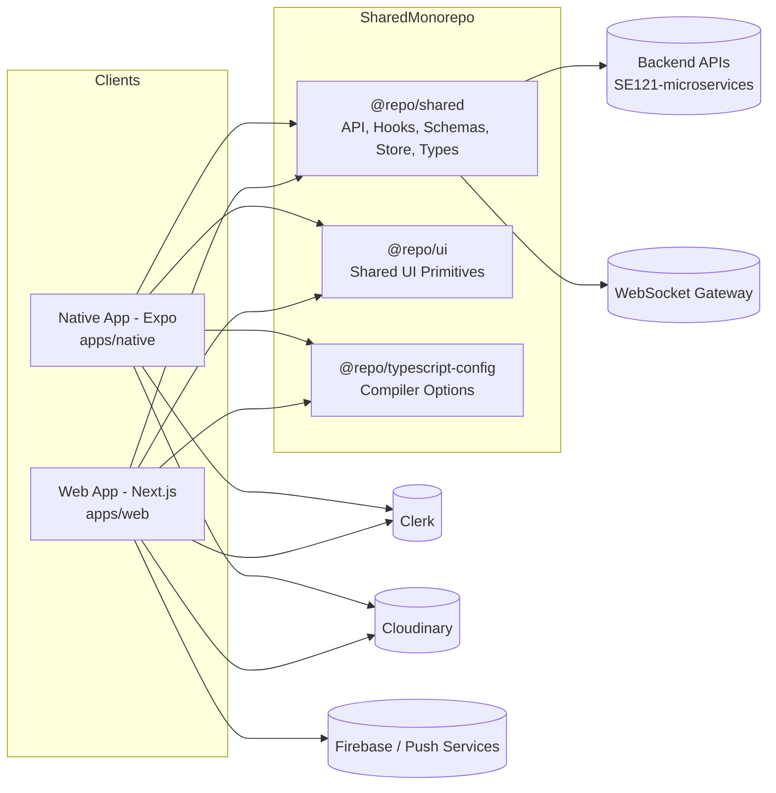

# Sentimeta Frontend Blueprint (`social-network-2.0`)

👉 **Backend Repository:** [SE121-microservices](../SE121-microservices/README.md)

## System Overview
Sentimeta is a modern cross-platform social networking ecosystem deeply integrated with Artificial Intelligence (AI) technologies including Emotion Intelligence, Mental Health RAG Chatbots, and Personalized Recommendation Engines. The frontend architecture is organized as a Turborepo monorepo delivering parity across Web (Next.js 15 App Router) and Mobile (Expo SDK 55 React Native) through a shared business and data layer (`@repo/shared`).



## Local Interface & Invariants
- `vitest.workspace.ts`: Root test workspace configuring Vitest test runners across packages and apps.

## Subdirectories & System Boundaries
- [apps](./apps/README.md) - Client applications delivering web and native user experiences.
  - [web](./apps/web/README.md): Next.js 15 App Router web client with Clerk auth, TanStack Query, and Tailwind CSS v4.
  - [native](./apps/native/README.md): Expo SDK 55 cross-platform mobile client with Uniwind and HeroUI Native.
- [packages](./packages/README.md) - Reusable monorepo libraries and toolchains.
  - [shared](./packages/shared/README.md): Domain types, Zod schemas, API services, Zustand stores, and React Query hooks.
  - [ui](./packages/ui/README.md): Cross-platform UI primitives and style bindings.
  - [typescript-config](./packages/typescript-config/README.md): Shared TypeScript compiler options (`base.json`, `nextjs.json`, `react-native-library.json`).

## Global Invariants
- All client interactions with backend microservices must import DTO schemas and API clients from `[shared](./packages/shared/README.md)`.
- Cross-platform UI components must use React Native primitives to preserve web and mobile layout parity.
- Authentication tokens must be managed through Clerk session interceptors before forwarding requests to the Backend API Gateway.
- Monorepo compilation and caching are governed by Turborepo (`turbo.json`).

## Global Side Effects
- Communicates over HTTP and WebSocket protocols with the `SE121-microservices` backend API Gateway (`:4000`).
- Direct media asset uploads to Cloudinary storage buckets.
- Browser and native push notification token registration with Firebase Cloud Messaging (FCM).

## System Verification
- Run: `npm run typecheck`
- Run: `npm run lint`
- Run: `npm test`

---

## 📸 UI Showcase

| Newsfeed (Web & App) | Realtime Chat & AI Chatbot | Profile & Emotion Analytics |
| :---: | :---: | :---: |
| `` | `` | `` |
| Personalized newsfeed driven by Recommendation AI. | Realtime chat messaging and empathetic AI Assistant dialogues. | User profile with integrated Emotion AI analytics and trends. |

---

## ✨ Key Features

- **🤖 AI-Powered Features:**
  - **Emotion Intelligence:** Automated emotion sentiment analysis from user content and interaction history.
  - **Smart Chatbot:** Context-aware RAG virtual assistant directly integrated into real-time chat.
  - **Recommendation Engine:** Personalized content, friend, and community group suggestions based on user affinity.
- **📱 Cross-Platform Support:** 
  - **Web App:** Built with Next.js 15 (App Router), React 19, and Tailwind CSS v4.
  - **Native App:** Smooth mobile experience powered by Expo SDK 55, React Native, Uniwind, and HeroUI Native.
- **⚡ Realtime & Social:**
  - Realtime WebSocket messaging (1-on-1 and group chats).
  - Community groups management, friendships, and notification feeds.
- **🏗 Monorepo Architecture:** Maximum business logic reuse (API clients, Zod schemas, Zustand stores, React Query hooks) through `@repo/shared`.

---

## 🚀 Quick Start

### 1. Start the Backend
Refer to detailed instructions in the [SE121-microservices README](../SE121-microservices/README.md).

### 2. Start the Frontend

```bash
cd social-network-2.0

# Install dependencies
npm ci

# Set up environment files
cp apps/web/.env.example apps/web/.env
cp apps/native/.env.example apps/native/.env
```

*Populate Clerk, Firebase, Cloudinary, and API credentials in the generated `.env` files.*

```bash
# Start all workspaces (Web & Native) in parallel
npm run dev

# Or start individual workspaces independently:
npm run dev --workspace web
npm run dev --workspace sentimeta-native
```

**Commands for Native Platform:**
```bash
npm run android --workspace sentimeta-native
npm run ios --workspace sentimeta-native
```

---

## 🔐 Environment Variables

### 1. Web (`apps/web/.env`)

| Category | Environment Variables |
|---|---|
| **Clerk Auth** | `NEXT_PUBLIC_CLERK_PUBLISHABLE_KEY`, `CLERK_SECRET_KEY`, `CLERK_WEBHOOK_SIGNING_SECRET` |
| **Clerk Routes** | `NEXT_PUBLIC_CLERK_SIGN_IN_URL`, `NEXT_PUBLIC_CLERK_SIGN_UP_URL`, `NEXT_PUBLIC_CLERK_SIGN_IN_FALLBACK_REDIRECT_URL`, `NEXT_PUBLIC_CLERK_SIGN_UP_FALLBACK_REDIRECT_URL` |
| **Backend & WS** | `NEXT_PUBLIC_BACKEND_API_URL`, `NEXT_PUBLIC_WS_URL` |
| **Cloudinary** | `NEXT_PUBLIC_CLOUDINARY_CLOUD_NAME`, `NEXT_PUBLIC_CLOUDINARY_UPLOAD_PRESET` |
| **Firebase Push** | `NEXT_PUBLIC_FIREBASE_API_KEY`, `NEXT_PUBLIC_FIREBASE_AUTH_DOMAIN`, `NEXT_PUBLIC_FIREBASE_PROJECT_ID`, `NEXT_PUBLIC_FIREBASE_STORAGE_BUCKET`, `NEXT_PUBLIC_FIREBASE_MESSAGING_SENDER_ID`, `NEXT_PUBLIC_FIREBASE_APP_ID`, `NEXT_PUBLIC_FIREBASE_VAPID_KEY` |

### 2. Native (`apps/native/.env`)

| Category | Environment Variables |
|---|---|
| **Clerk Auth** | `EXPO_PUBLIC_CLERK_PUBLISHABLE_KEY` |
| **Backend & WS** | `EXPO_PUBLIC_API_URL`, `EXPO_PUBLIC_WS_URL` |
| **Cloudinary** | `EXPO_PUBLIC_CLOUDINARY_CLOUD_NAME`, `EXPO_PUBLIC_CLOUDINARY_UPLOAD_PRESET` |

---

## 📜 Workspace Scripts

Run from the repository root (`social-network-2.0/`):

| Command | Description |
|---|---|
| `npm run dev` | Launch all monorepo apps in development mode with Turborepo |
| `npm run lint` | Run ESLint across all workspaces |
| `npm run typecheck` | Run TypeScript type checks across all workspaces |
| `npm run build` | Execute production builds across Turborepo dependency graph |
| `npm run ci` | Run lint, typecheck, and build sequence |
| `npm run format` | Run Prettier code formatting |

---

## 📄 Official Documentation References

- **Next.js (Web Framework):** [https://nextjs.org/docs](https://nextjs.org/docs)
- **Expo (Mobile Framework):** [https://docs.expo.dev](https://docs.expo.dev)
- **Clerk (Authentication):** [https://clerk.com/docs](https://clerk.com/docs)
- **Turborepo (Monorepo Build System):** [https://turbo.build/repo/docs](https://turbo.build/repo/docs)
- **Tailwind CSS v4:** [https://tailwindcss.com/docs](https://tailwindcss.com/docs)
- **React Query (Data Fetching):** [https://tanstack.com/query](https://tanstack.com/query)
- **Zustand (State Management):** [https://docs.pmnd.rs/zustand](https://docs.pmnd.rs/zustand)
- **Zod (Schema Validation):** [https://zod.dev](https://zod.dev)
- **HeroUI Native (Mobile UI):** [https://heroui.com](https://heroui.com)
