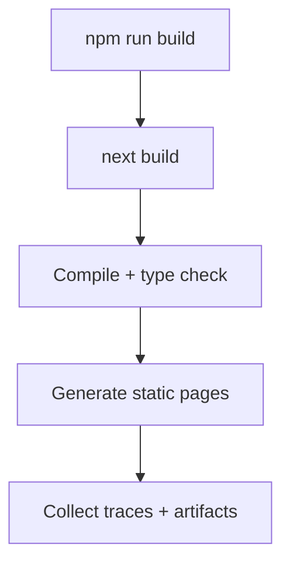

# Web App (`apps/web`)

## Overview
Web application for Sentimeta, built using Next.js 15 (App Router), React 19, Tailwind CSS v4, and HeroUI. Provides rich responsive web user interfaces for newsfeeds, realtime direct and group messaging, AI mental health chatbot interactions, emotion intelligence analytics, music recommendations, and administrative moderation.

## Interface
- **App Router Pages** (`./app`): Platform route groups: `(platform)/(clerk)` (authentication), `(platform)/(main)` (newsfeed, chat, profiles, emotion dashboard), `(platform)/admin` (system moderation and metrics), and `api/` (Next.js server-side route handlers).
- **Core Components & Hooks** (`./components`, `./hooks`): Feature-level components for feed posts, comment threads, emotion analysis charts, chat dialogs, and admin hooks.
- **Dependencies & Packages**: Consumes `[shared](../../packages/shared/README.md)`, `[ui](../../packages/ui/README.md)`, and `[typescript-config](../../packages/typescript-config/README.md)`.

## Invariants
- Route access to `(platform)/(main)` and `(platform)/admin` requires valid Clerk session tokens.
- Server actions and client components must query backend microservices through `@repo/shared` API clients or dedicated API gateway routes.
- Required environment variables (`NEXT_PUBLIC_CLERK_PUBLISHABLE_KEY`, `NEXT_PUBLIC_BACKEND_API_URL`, `NEXT_PUBLIC_WS_URL`) must be properly configured.

## Side Effects
- Issues HTTP and WebSocket requests to the backend microservices via API Gateway (`:4000`).
- Manages client-side storage (cookies, localStorage) for auth sessions, dark mode, and UI layout preferences.
- Interacts with Firebase Cloud Messaging (FCM) Service Worker for browser push notifications.
- Direct uploads of media assets to Cloudinary.

## Verification
- Run: `npm run typecheck`
- Run: `npm run lint`
- Run: `npm run build`

---

## Architecture & Development Details

### 1. Overview

- Runtime: Next.js 15 + React 19
- Auth: Clerk
- Server state: TanStack Query
- Push: Firebase Web Push (optional based on environment)

### 2. Architecture

```mermaid
flowchart LR
  UI[App Router pages/layouts] --> Features[Feature components]
  Features --> Shared[@repo/shared hooks/types]
  Shared --> API[Backend API]
  UI --> Clerk[Clerk auth]
  UI --> SW[Service Worker]
  SW --> FCM[Firebase Cloud Messaging]
```

### 3. Folder Map

```text
apps/web/
  app/
    (platform)/
      (clerk)/
      (main)/
      admin/
    api/
    marketing/
  docs/
    FCM_SETUP.md
    SERVICE_WORKER_ENV.md
```

### 4. Local Development

From the repository root:

```bash
npm run dev --workspace web
```

Or inside the `apps/web` directory:

```bash
npm run dev
```

### 5. Environment

Create an environment configuration file:

```bash
cp .env.example .env
```

Key environment variables:

- Clerk: `NEXT_PUBLIC_CLERK_PUBLISHABLE_KEY`, `CLERK_SECRET_KEY`, `CLERK_WEBHOOK_SIGNING_SECRET`
- Backend: `NEXT_PUBLIC_BACKEND_API_URL`, `NEXT_PUBLIC_WS_URL`
- Cloudinary: `NEXT_PUBLIC_CLOUDINARY_CLOUD_NAME`, `NEXT_PUBLIC_CLOUDINARY_UPLOAD_PRESET`
- OpenAI: `OPENAI_API_KEY`
- Firebase: `NEXT_PUBLIC_FIREBASE_*`

### 6. Quality Checks

```bash
npm run lint
npm run typecheck
npm run build
```

### 7. Build Flow



### 8. Push Notification Documentation

- `docs/FCM_SETUP.md`
- `docs/SERVICE_WORKER_ENV.md`

### 9. Deployment

- Build output: Next.js production bundle
- Target: Vercel or any Node.js runtime compatible with Next.js 15
